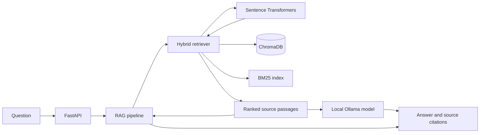

# JKLU Compass

JKLU Compass is a local-first retrieval-augmented generation (RAG) assistant for questions about JK Lakshmipat University. It searches a curated university knowledge base, drafts an answer with a local Ollama model, and returns references to the sources used.

This repository currently exposes a FastAPI service; it does not include a web frontend. A populated local ChromaDB collection and a running Ollama model are required to answer questions.

## What it does

- Retrieves passages using dense embeddings and BM25 keyword search, then combines their rankings.
- Limits duplicate sources while preserving especially relevant evidence, such as a requested degree’s fee row or a complete list.
- Answers from retrieved JKLU documents and returns source titles, URLs, and chunk IDs.
- Uses deterministic rendering for supported structured answers, including B.Tech programme lists and fee questions with matching source evidence.
- Includes retrieval evaluation and candidate-diagnostic scripts.

## How it works



At startup, the service loads the embedding model and builds an in-memory BM25 index from the existing Chroma records. For each question, dense and keyword retrieval feed a reciprocal-rank-fusion step and source-aware selection. The RAG pipeline then prepares evidence for the answer. Queries do not add, delete, or re-embed Chroma records.

## Requirements

- Python **3.11 or 3.12**
- [Ollama](https://ollama.com/) with the configured model available locally
- A non-empty Chroma collection named `jklu_compass` at `data/chroma`
- Curated Markdown source files under `data/raw/` if you need to build the index yourself

The raw corpus, active Chroma database, and evaluation benchmark are local data artifacts and are not included in a fresh checkout. The API checks for an existing, non-empty collection and will refuse to start without it.

## Quick start

### 1. Create an environment and install the project

```bash
python3.12 -m venv .venv
source .venv/bin/activate
```

On Windows PowerShell, create and activate the environment with:

```powershell
py -3.12 -m venv .venv
.venv\Scripts\Activate.ps1
```

Then install the project, development tools, and ASGI server:

```bash
python -m pip install --upgrade pip
python -m pip install -e ".[dev]" "uvicorn[standard]"
```

The first embedding-model load may download `sentence-transformers/all-MiniLM-L6-v2` if it is not already cached.

### 2. Start Ollama

The default model is `qwen3.5:2b-q4_K_M`.

```bash
ollama pull qwen3.5:2b-q4_K_M
ollama serve
```

If Ollama is already running as a background service, the `ollama serve` command is not needed.

### 3. Provide or build the knowledge base

To build a new local index, place the curated Markdown source files in `data/raw/`, then run:

```bash
python scripts/index_jklu_dataset.py --batch-size 32
```

This command writes embeddings and documents to `data/chroma`. It does not clear existing records by default. Use `--sync` only when you intend to remove obsolete chunks from successfully processed sources. `--reset` deletes the existing collection before indexing.

If you already have the prepared Chroma database, place it at `data/chroma` and confirm it contains the `jklu_compass` collection. Do not run the indexing command unless you intend to write to that database.

### 4. Run the API

```bash
uvicorn jklu_compass.api.main:app --reload --host 127.0.0.1 --port 8000
```

The server starts on `http://127.0.0.1:8000`. Interactive API documentation is available at [`/docs`](http://127.0.0.1:8000/docs) and [`/redoc`](http://127.0.0.1:8000/redoc).

## API

### Health check

```bash
curl http://127.0.0.1:8000/health
```

### Ask a question

```bash
curl -X POST http://127.0.0.1:8000/api/v1/query \
  -H "Content-Type: application/json" \
  -d '{"question":"What B.Tech specialisations are available at JKLU?"}'
```

The request accepts a `question` string from 1 to 2,000 characters. The response contains:

- `answer`: answer text, with `[Source N]` labels when the generator includes inline citations.
- `sources`: source number, title, URL (when available), and chunk ID.
- `retrieved_chunks`: number of passages retrieved for the question.
- `structured_data`: optional machine-readable programme data for supported structured answers.

The query endpoint returns HTTP 503 when the local Ollama model is unavailable.

## Defaults

| Component | Current default |
|---|---|
| Embedding model | `sentence-transformers/all-MiniLM-L6-v2` |
| Ollama model | `qwen3.5:2b-q4_K_M` |
| Ollama endpoint | `http://localhost:11434` |
| Chroma directory | `data/chroma` |
| Chroma collection | `jklu_compass` |
| API retrieval count | 8 passages |

These defaults are set in the Python constructors and API builder; the project does not currently load runtime settings from a `.env` file.

## Tests and retrieval evaluation

Run the test suite and code checks with the development dependencies installed:

```bash
pytest
ruff check .
ruff format --check .
```

The read-only retrieval evaluation uses `data/evaluation/benchmark.json`, evaluates at top 6, and writes a JSON report under `data/evaluation/results/`:

```bash
python scripts/evaluate_retrieval.py
```

The benchmark file is local and is not included in a fresh checkout. The evaluation checks the Chroma record count before and after the run.

To inspect production retrieval candidates and selection reasons:

```bash
python scripts/diagnose_retrieval_candidates.py
```

The diagnostic expects the 5,716-record project snapshot and also writes its report under `data/evaluation/`. For a quick dense-retrieval check with your own question:

```bash
python scripts/test_jklu_retrieval.py --query "What are the annual B.Tech fees?" --top-k 5
```

That last script tests dense retrieval only; use the API endpoint to exercise the full RAG path.

The latest recorded 24-question retrieval run (6 November 2026) reports Precision@6 **0.1806**, Recall@6 **0.6875**, Hit rate@6 **0.7917**, and MRR **0.6035**. See the [retrieval follow-up report](docs/evaluation/retrieval_followup_20261106.md) for question-level results and remaining gaps.

## Project layout

```text
src/jklu_compass/
├── api/          FastAPI app and request/response schemas
├── embeddings/   Sentence Transformers encoder
├── evaluation/  Benchmark loading and retrieval metrics
├── generation/  Local Ollama client
├── ingestion/   Markdown loading, cleaning, chunking, and indexing
├── rag/         Context preparation and answer generation
├── retrieval/   Dense/BM25 hybrid retrieval and source selection
└── vectorstore/ ChromaDB persistence and search

scripts/          Indexing, evaluation, retrieval, and diagnostics
tests/            Unit and API tests
data/raw/         Local Markdown source corpus (not committed)
data/chroma/      Local ChromaDB collection (not committed)
data/evaluation/  Local benchmark and generated reports (not committed)
```

## Troubleshooting

- **API refuses to start:** confirm that `data/chroma` exists and contains a non-empty `jklu_compass` collection.
- **HTTP 503 / Ollama connection error:** start Ollama, check that `qwen3.5:2b-q4_K_M` is installed with `ollama list`, and verify the endpoint at `http://localhost:11434`.
- **No useful source passages:** check that the active index was built from the intended Markdown corpus and run the retrieval evaluation or diagnostic script.
- **A fact looks outdated or is missing:** the assistant can only use the locally indexed documents. Refresh the source corpus and index intentionally when updated official material is available.
